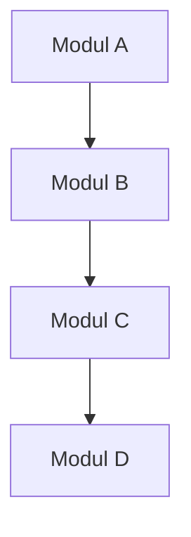
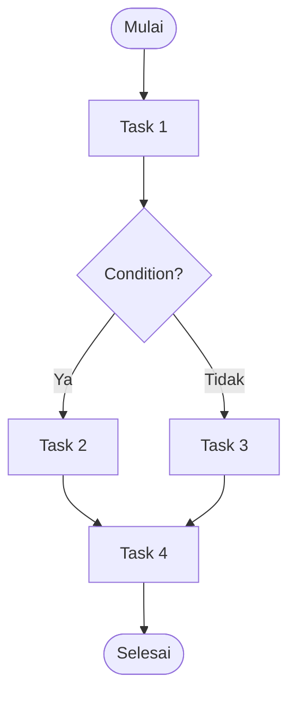
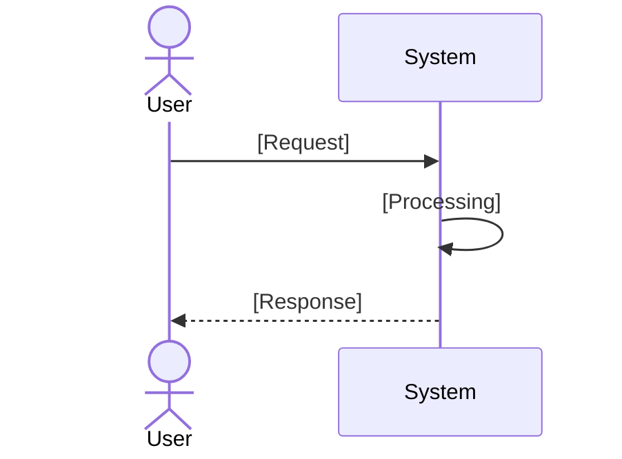
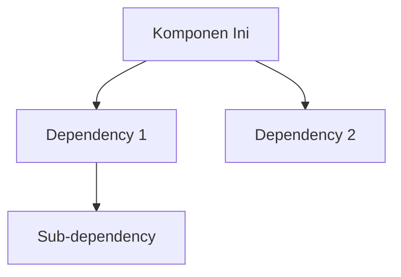
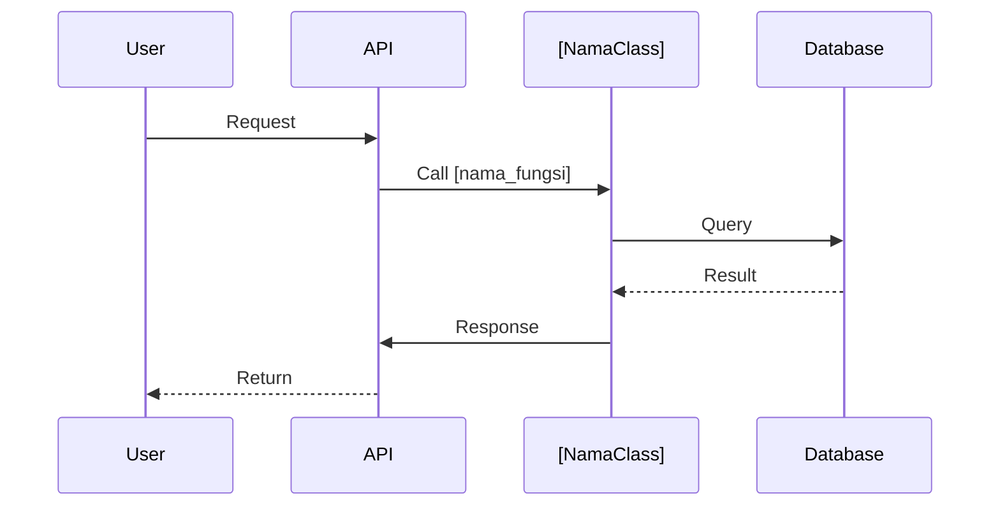

## **Akses dan gunakan MusGo Library sebagai knowledge Base generate MusGo-OS 2in1 Blueprint Repository di github: Musgo-OS-2in1_Blueprint_Repository**

## **File "System Prompt Instruction Musgo-OS Custom.md" merupakan Single Source of Truth (SSOT) dan menjadi referensi utama seluruh proses analisis, perancangan, dan pembangunan repository, dan File "Core V9.1 Update Master Index Repo.md" sebagai single referensi MusGo-OS 2in1 Repository Struktur**

## **Kerjakan sesuai arahan dan flow berikut**

## ⚡ **TAHAP 1: BLUEPRINT CONTOH (TEMPLATE)**

**template blueprint** harus menerapkannya ke semua komponen.

### **📄 TEMPLATE_BLUEPRINT.md**

```markdown
# [NAMA KOMPONEN]

**Path:** `[path/ke/komponen]`  \
**Domain:** [Domain]  \
**Layer:** [Layer Number]  \
**Tipe:** [Python Module / Configuration / Documentation]  \
**Status:** Production-Ready  \
**Version:** V9.1

---

## 📋 DAFTAR ISI
1. [Deskripsi](#deskripsi)
2. [Modul](#modul)
3. [Fungsi](#fungsi)
4. [Tugas (Tasks)](#tugas-tasks)
5. [Task Flow](#task-flow)
6. [User Flow](#user-flow)
7. [Dependencies](#dependencies)
8. [Security Considerations](#security-considerations)
9. [Configuration](#configuration)
10. [Error Handling](#error-handling)
11. [Monitoring & Observability](#monitoring--observability)
12. [Contoh Kode](#contoh-kode)
13. [Diagram](#diagram)

---

## 📝 1. DESKRIPSI

### Tujuan
[Deskripsi tujuan komponen ini]

### Fungsi Utama
- [Fungsi 1]
- [Fungsi 2]
- [Fungsi 3]

### Ruang Lingkup
- [Lingkup 1]
- [Lingkup 2]

### Prinsip Operasi
[Prinsip kerja komponen]

---

## 🗃️ 2. MODUL

### Modul Internal
| Nama Modul | Deskripsi | File |
|------------|-----------|------|
| [Modul 1] | [Deskripsi] | [file.py] |
| [Modul 2] | [Deskripsi] | [file.py] |

### Hubungan Modul


---

## ⚙️ 3. FUNGSI

### `fungsi_1(parameter)`
- **Deskripsi:** [Deskripsi fungsi]
- **Parameter:**
  - `param1` (type): [deskripsi]
  - `param2` (type): [deskripsi]
- **Return:** [type] - [deskripsi]
- **Raises:**
  - `Exception1`: [kondisi]
  - `Exception2`: [kondisi]
- **Contoh Pemakaian:**
  ```python
  hasil = fungsi_1(param1, param2)
  ```

### `fungsi_2(parameter)`
[...]

---

## ✅ 4. TUGAS (TASKS)
```
| ID | Nama Task | Deskripsi | Trigger | Output |
|----|-----------|-----------|---------|--------|
| T01 | [Nama Task] | [Deskripsi] | [Trigger] | [Output] |
| T02 | [Nama Task] | [Deskripsi] | [Trigger] | [Output] |
```
---

## 🔄 5. TASK FLOW



### Keterangan Alur:
1. [Langkah 1]
2. [Langkah 2]
3. [Langkah 3]

---

## 👤 6. USER FLOW

### Alur Interaksi:
1. **User Action:** [Aksi user]
2. **System Response:** [Respons sistem]
3. **Next Step:** [Langkah berikutnya]

### Diagram User Flow:


---
---

## 🔗 7. DEPENDENCIES
```
### Internal Dependencies
| Komponen | Deskripsi | Path |
|----------|-----------|------|
| [Komponen 1] | [Deskripsi] | [path] |
| [Komponen 2] | [Deskripsi] | [path] |

### External Dependencies
| Library/Package | Versi | Tujuan |
|----------------|-------|--------|
| [Library 1] | [versi] | [tujuan] |
| [Library 2] | [versi] | [tujuan] |

### Dependency Graph:


---
---

## 🔒 8. SECURITY CONSIDERATIONS

### Authentication
- **Metode:** [JWT/OIDC/mTLS/None]
- **Implementasi:** [Deskripsi]

### Authorization
- **Role-Based Access:** [Ya/Tidak]
- **Permission Level:** [Level 1/2/3]

### Encryption
- **Data at Rest:** [AES-256/None]
- **Data in Transit:** [TLS 1.3/None]

### Audit Trail
- **Logging Level:** [DEBUG/INFO/WARNING/ERROR]
- **Retention:** [30/90/365 hari]
- **Immutable:** [Ya/Tidak]

### Security Hardening
- **Input Validation:** [Ya/Tidak]
- **Output Encoding:** [Ya/Tidak]
- **Rate Limiting:** [Ya/Tidak]

---
---

## ⚙️ 9. CONFIGURATION

### File Konfigurasi: `[nama_file].yaml`
```yaml
# Konfigurasi utama
parameter1: value1
parameter2:
  subparam1: value1
  subparam2: value2

# Konfigurasi keamanan
security:
  enabled: true
  tls: true
  auth_required: true

# Konfigurasi logging
logging:
  level: INFO
  file: /var/log/[komponen].log
  max_size: 100MB
  retention: 30
```
```
### Environment Variables
| Variable | Deskripsi | Default | Required |
|----------|-----------|---------|----------|
| `VAR_1` | [Deskripsi] | `default` | Ya |
| `VAR_2` | [Deskripsi] | `default` | Tidak |
```
---
---

## ❌ 10. ERROR HANDLING
```
### Error Types
| Error Code | Nama | Deskripsi | Recovery Strategy | Logging |
|------------|------|-----------|-------------------|--------|
| ERR_001 | ValidationError | Input tidak valid | Return 400 | ERROR |
| ERR_002 | AuthError | Autentikasi gagal | Return 401 | WARNING |
| ERR_003 | InternalError | Error internal | Retry/Notify | ERROR |
```
### Error Handling Strategy
```python
try:
    # Kode utama
    result = operation()
    return result
except ValidationError as e:
    logger.error(f\"Validation failed: {e}\")
    raise HTTPException(status_code=400, detail=str(e))
except AuthError as e:
    logger.warning(f\"Authentication failed: {e}\")
    raise HTTPException(status_code=401, detail=\"Unauthorized\")
except Exception as e:
    logger.critical(f\"Unexpected error: {e}\", exc_info=True)
    raise HTTPException(status_code=500, detail=\"Internal Server Error\")
```

### Retry Mechanism
- **Max Retries:** 3
- **Backoff Strategy:** Exponential (1s, 2s, 4s)
- **Circuit Breaker:** [Aktif/Tidak]

---
---

## 📊 11. MONITORING & OBSERVABILITY
```
### Metrics
| Metric | Type | Deskripsi | Target |
|--------|------|-----------|--------|
| `requests_total` | Counter | Total request | Prometheus |
| `request_latency` | Histogram | Latensi request | Prometheus |
| `errors_total` | Counter | Total error | Prometheus |
| `active_connections` | Gauge | Koneksi aktif | Prometheus |

### Logging
- **Format:** JSON
- **Level:** INFO
- **Fields:** timestamp, level, message, component, trace_id

### Tracing
- **Provider:** [OpenTelemetry/Jaeger]
- **Sampling Rate:** 100%
- **Trace Context:** [W3C Standard]

### Alerting
| Alert | Condition | Severity | Notification |
|-------|-----------|----------|--------------|
| HighErrorRate | error_rate > 5% | CRITICAL | Email/SMS |
| HighLatency | latency > 1s | WARNING | Slack |
| Down | status == down | CRITICAL | PagerDuty |
```
---
---

## 💻 12. CONTOH KODE

### Implementasi Utama
```python
import logging
from typing import Optional
from pydantic import BaseModel, ValidationError

logger = logging.getLogger(__name__)

class [NamaClass]Input(BaseModel):
    param1: str
    param2: int

class [NamaClass]:
    def __init__(self, config: dict):
        self.config = config
        self.logger = logger

    def [nama_fungsi](self, input: [NamaClass]Input) -> dict:
        """
        [Deskripsi fungsi]

        Args:
            input: [Deskripsi input]

        Returns:
            dict: [Deskripsi output]

        Raises:
            ValidationError: Jika input tidak valid
            RuntimeError: Jika terjadi error runtime
        """
        try:
            # Validasi input
            validated_input = input.dict()

            # Logik utama
            result = self._process(validated_input)

            # Logging
            self.logger.info(f\"[Fungsi] selesai diproses\", extra={
                \"input\": validated_input,
                \"result\": result
            })

            return result

        except ValidationError as e:
            self.logger.error(f\"Validasi gagal: {e}\")
            raise
        except Exception as e:
            self.logger.critical(f\"Error tidak terduga: {e}\", exc_info=True)
            raise RuntimeError(f\"Gagal memproses: {e}\") from e

    def _process(self, data: dict) -> dict:
        """Logik internal"""
        # Implementasi
        return {}
```

### Unit Test
```python
import pytest
from [module] import [NamaClass]

def test_[nama_fungsi]:
    # Setup
    config = {}
    instance = [NamaClass](config)

    # Test data
    input_data = [NamaClass]Input(param1="test", param2=123)

    # Execute
    result = instance.[nama_fungsi](input_data)

    # Assert
    assert result is not None
    assert isinstance(result, dict)
```

---
---

## 📐 13. DIAGRAM

### Arsitektur Komponen
```mermaid
classDiagram
    class [NamaClass] {
        +__init__(config)
        +[nama_fungsi](input) dict
        -_process(data) dict
    }

    class [DependencyClass] {
        +method()
    }

    [NamaClass] --> [DependencyClass] : uses
```

### Sequence Diagram


---
---

## 📚 REFERENSI

### Dokumentasi Terkait
- [Link ke dokumen 1]
- [Link ke dokumen 2]

### Standar yang Digunakan
- [Standar 1]
- [Standar 2]

### Best Practices
- [Praktik 1]
- [Praktik 2]

---
---

**Generated:** [Timestamp]  \
**Generated By:** MusGo-OS Blueprint Generator V1.0  \
**Status:** Draft/Reviewed/Approved

---
---

## 🎯 **RENCANA GENERASI BLUEPRINT**

### **Struktur yang Akan Dibuat:**

---
---

## 🚀 **TAHAP 2: GENERASI BLUEPRINT ACTUAL**

### **Prioritas 1: Constitutional Domain (Layer 00, 04, 06, 15)**
1. **Layer 00 Governor** (20+ files)
2. **Layer 04 Consensus Engine** (8 files)
3. **Layer 06 Policy Ethics Guard** (15+ files)
4. **Layer 15 Adaptive Self-Learning** (10 files)

### **Prioritas 2: Cognitive Domain (Layer 02, 03, 05)**
1. **Layer 02 Musyawarah Planner** (25+ files)
2. **Layer 03 GoRo Executor** (20+ files)
3. **Layer 05 Agent Orchestration** (50+ files - terbesar!)

### **Prioritas 3: Runtime Domain (Layer 01, 07-12)**
1. **Layer 01 Kernel Sovereignty** (30+ files)
2. **Layer 07 Event Bus** (15 files)
3. **Layer 08 Persistence Memory** (15 files)
4. **Layer 09 API Gateway** (10 files)
5. **Layer 10 Contract Registry** (10 files)
6. **Layer 11 Risk Engine** (10 files)
7. **Layer 12 Resource Engine** (20 files)

---
---
===========🔐™️®️©️🔐===========

🔹MusGo-OS 2in1🔹Ai-inside-OS🔹
(21 Layer Sovereign AI Operating Civilization)

🔹© 2026 — Dhani Yuliawan | All Rights Reserved🔹

===========🔐™️®️©️🔐===========

---
**FOUNDER SIGN: DHANI YULIAWAN**